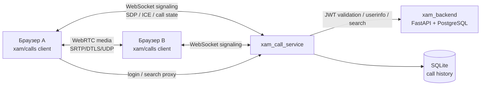

# xam_call_service

Сервис аудио- и видеозвонков для мессенджера **xam**: сигналинг, присутствие,
история звонков и небольшой WebRTC-клиент для проверки связи. Авторизация
выполняется токенами соседнего `xam_backend` (OAuth2 bearer / JWT), медиа идёт
напрямую между браузерами.

## Что реализовано

- **Backend на FastAPI** с асинхронным WebSocket-сигналингом.
- **Авторизация через соседний `xam_backend`**:
  - локальная проверка JWT (HS256 с общим `SECRET_KEY` или RS256/ES256 через JWKS);
  - RFC 7662 introspection для непрозрачных токенов;
  - режим проверки через `GET /api/v1/users/me` соседнего сервиса;
  - прокси-эндпоинты `/auth/login`, `/auth/register`, `/users/me`,
    `/users/search`, чтобы тестовому клиенту не требовался CORS на бэкенде.
- **1:1 аудио- и видеозвонки**: приглашение, принятие, отклонение, отмена,
  завершение, таймаут, максимальная длительность, восстановление после
  короткого обрыва WebSocket.
- **WebRTC-сигналинг через WebSocket**: SDP offer/answer и ICE-кандидаты
  пересылаются только участникам звонка; сервер валидирует и санитизирует данные.
- **Presence**: подписка на выбранных пользователей, статусы `online` и `in_call`.
- **История звонков** в SQLite (SQLAlchemy async): направление, собеседник,
  тип звонка, статус, длительность.
- **Короткоживущие одноразовые WS-тикеты**, чтобы не светить access token в URL.
- **Маленький клиент без сборки** (`app/static`): вход/регистрация/токен,
  поиск пользователей, входящие/исходящие звонки, mute, камера, таймер,
  статистика WebRTC, журнал сигналинга и диагностика.
- **Docker** и **тесты** (`pytest`, `ruff`).

## Архитектура



Почему так:

- **Медиа не идёт через Python-сокеты.** Для 1:1 звонков WebRTC передаёт
  аудио/видео напрямую по SRTP/DTLS поверх UDP с аппаратными кодеками,
  эхо-подавлением и адаптацией битрейта. Сервер только сигнализирует.
- **WebSocket** выбран для сигналинга: он уже используется в `xam_backend`,
  работает через тот же nginx/Vite-прокси и поддерживает мгновенную доставку
  событий.
- Для звонков через NAT нужен **TURN** (см. `TURN_URLS`), иначе часть соединений
  не установится. STUN по умолчанию — Google STUN.
- Групповые звонки потребуют SFU (например, LiveKit или mediasoup): текущая
  версия — только 1:1.

## Интеграция с соседним сервисом

`xam_backend` выдаёт JWT с полями `sub` (UUID пользователя), `type: "access"`,
`iat`, `exp`, подписанный `SECRET_KEY`. Сервис звонков работает как
OAuth2 resource server: проверяет подпись/срок и извлекает `sub`.

По умолчанию:

```env
AUTH_MODE=jwt
SECRET_KEY=dev-secret-key-change-me-32-bytes-min
JWT_ALGORITHMS=HS256
AUTH_ENRICH_USERINFO=true
BACKEND_BASE_URL=http://localhost:8000
```

`SECRET_KEY` должен совпадать со значением в `.env` `xam_backend`. Если ключи
разные, REST вернёт `401`, а WebSocket закроется кодом `1008`.

Режимы авторизации:

| `AUTH_MODE` | Что делает | Когда использовать |
| --- | --- | --- |
| `jwt` | Проверяет JWT локально: общий секрет или JWKS | Основной режим для `xam_backend` |
| `introspect` | `POST` на RFC 7662 introspection endpoint | Непрозрачные токены OAuth2 |
| `backend` | Проверяет токен через `GET /api/v1/users/me` | Токен нельзя проверить локально, но есть `xam_backend` |

Для внешнего OIDC-провайдера задайте `OAUTH2_JWKS_URL`, `JWT_ALGORITHMS`
(например, `RS256`), при необходимости `JWT_ISSUER` и `JWT_AUDIENCE`.

`AUTH_ENRICH_USERINFO=true` подтягивает `username`/`display_name` из
`xam_backend` и кеширует их на `USERINFO_CACHE_TTL_SECONDS`. При сетевой ошибке
локально валидный токен продолжает работать; ответ `401/403` от бэкенда
считается невалидным токеном.

## Быстрый старт

### 1. Запустите `xam_backend`

В соседнем каталоге:

```bash
cd ../xam_backend
docker compose up --build
```

API будет на `http://localhost:8000`. Убедитесь, что `SECRET_KEY` в его `.env`
совпадает с ключом сервиса звонков.

### 2. Запустите сервис звонков

Windows PowerShell:

```powershell
python -m venv .venv
.\.venv\Scripts\python.exe -m pip install -r requirements-dev.txt
copy .env.example .env
.\.venv\Scripts\python.exe -m uvicorn main:app --reload --port 8081
```

Если `python -m venv` перехватывается Windows Store shim, создайте окружение
полным путём к установленному Python:

```powershell
& "$env:LOCALAPPDATA\Programs\Python\Python314\python.exe" -m venv .venv
```

Linux/macOS:

```bash
python3 -m venv .venv
source .venv/bin/activate
pip install -r requirements-dev.txt
cp .env.example .env
uvicorn main:app --reload --port 8081
```

Откройте **http://localhost:8081/client/**.

- Swagger UI: http://localhost:8081/docs
- Health: http://localhost:8081/health

### 3. Проверьте звонок

1. Откройте клиент в двух окнах браузера (обычное и приватное).
2. Зарегистрируйте двух пользователей или войдите существующими.
3. Найдите второго по username.
4. Нажмите «Видео» или «Аудио», во втором окне примите звонок.
5. Разрешите браузеру доступ к камере/микрофону.

> Камера и микрофон доступны только в secure context: `localhost` или HTTPS.
> При открытии по IP без HTTPS браузер заблокирует `getUserMedia`.

### Токен из мессенджера

Клиент понимает токен в hash-части ссылки, поэтому из `xam_frontend` можно
открыть его так:

```ts
const url = `http://localhost:8081/client/#token=${encodeURIComponent(token)}`;
window.open(url, '_blank', 'noopener');
```

Hash не уходит на сервер, а клиент сразу очищает его через `history.replaceState`.

## REST API

Все эндпоинты, кроме `/health`, `/auth/login` и `/auth/register`, требуют
`Authorization: Bearer <access_token>`.

| Метод | Путь | Назначение |
| --- | --- | --- |
| `GET` | `/health` | Проверка живости |
| `POST` | `/api/v1/auth/login` | Прокси входа в `xam_backend` |
| `POST` | `/api/v1/auth/register` | Прокси регистрации в `xam_backend` |
| `GET` | `/api/v1/users/me` | Текущий пользователь + `online`/`in_call` |
| `GET` | `/api/v1/users/search?q=&limit=` | Поиск пользователей + присутствие |
| `GET` | `/api/v1/calls/config` | ICE-серверы и таймауты |
| `POST` | `/api/v1/calls/ws-ticket` | Одноразовый тикет для WebSocket |
| `GET` | `/api/v1/calls/history?limit=&offset=` | История звонков |
| `GET` | `/api/v1/calls/active` | Текущий звонок или `null` |
| `GET` | `/api/v1/calls/{call_id}` | Детали активного/завершённого звонка |

Пример ответа `/calls/config`:

```json
{
  "ice_servers": [{ "urls": ["stun:stun.l.google.com:19302"] }],
  "ring_timeout_seconds": 45,
  "disconnect_grace_seconds": 10,
  "max_call_duration_seconds": 14400,
  "media": ["audio", "video"]
}
```

## WebSocket-сигналинг

Подключение:

```
ws://localhost:8081/ws/calls?ticket=<одноразовый-тикет>
```

Тикет выдаёт `POST /api/v1/calls/ws-ticket`, живёт `WS_TICKET_TTL_SECONDS`
(по умолчанию 30 секунд) и используется один раз. Для отладки поддерживается
fallback `?token=<jwt>`, но тикет предпочтительнее: access token не попадает
в URL и access-логи.

### Клиент → сервер

| `type` | `data` | Описание |
| --- | --- | --- |
| `ping` | — | Проверка соединения; можно отправить текстом `ping` |
| `presence.watch` | `{ "user_ids": ["uuid", ...] }` | Подписаться на статусы (до 100) |
| `presence.unwatch` | `{ "user_ids": [...] }` | Отписаться |
| `call.invite` | `{ "to_user_id": "uuid", "media": "audio"\|"video" }` | Позвонить |
| `call.accept` | `{ "call_id": "uuid" }` | Принять входящий |
| `call.reject` | `{ "call_id": "uuid" }` | Отклонить входящий |
| `call.cancel` | `{ "call_id": "uuid" }` | Отменить исходящий до ответа |
| `call.hangup` | `{ "call_id": "uuid" }` | Завершить звонок |
| `webrtc.offer` | `{ "call_id": "uuid", "sdp": "..." }` | SDP offer |
| `webrtc.answer` | `{ "call_id": "uuid", "sdp": "..." }` | SDP answer |
| `webrtc.ice` | `{ "call_id": "uuid", "candidate": {...}\|null }` | ICE-кандидат |

### Сервер → клиент

| `type` | `data` | Описание |
| --- | --- | --- |
| `ready` | `{ user, call, ring_timeout_seconds, ... }` | Сессия готова; `call` — текущий звонок или `null` |
| `pong` | — | Ответ на ping |
| `presence.state` | `{ user_id, online, in_call }` | Статус watched-пользователя |
| `call.ringing` | `{ call }` | Исходящий звонок создан |
| `call.incoming` | `{ call }` | Входящий звонок |
| `call.accepted` | `{ call }` | Звонок принят |
| `call.rejected` | `{ call }` | Звонок отклонён |
| `call.cancelled` | `{ call }` | Звонок отменён звонящим |
| `call.ended` | `{ call }` | Завершён: `hangup`, `timeout`, `disconnected`, `max_duration`, `server_shutdown` |
| `webrtc.offer` | `{ call_id, from_user_id, sdp }` | Offer от собеседника |
| `webrtc.answer` | `{ call_id, from_user_id, sdp }` | Answer от собеседника |
| `webrtc.ice` | `{ call_id, from_user_id, candidate }` | ICE-кандидат |
| `error` | `{ code, detail }` | Ошибка сигналинга |

Объект звонка:

```json
{
  "id": "uuid",
  "caller": { "id": "uuid", "username": "alice", "display_name": "Alice" },
  "callee": { "id": "uuid", "username": "bob", "display_name": "Bob" },
  "media": "video",
  "state": "ringing",
  "status": "ringing",
  "end_reason": null,
  "created_at": "2026-11-03T12:00:00+00:00",
  "answered_at": null,
  "ended_at": null,
  "duration_seconds": 0
}
```

Коды ошибок: `invalid_json`, `invalid_event`, `invalid_payload`, `unknown_event`,
`user_offline`, `self_call`, `caller_busy`, `callee_busy`, `call_not_found`,
`forbidden`, `invalid_state`, `rate_limited`, `payload_too_large`,
`internal_error`.

### Поведение звонка

- Один пользователь может участвовать только в одном звонке.
- Нельзя позвонить себе или пользователю не в сети.
- Приглашение «звонит» `RING_TIMEOUT_SECONDS`; по таймауту статус `missed`.
- После принятия работает лимит `MAX_CALL_DURATION_SECONDS` (0 — без лимита).
- Если последняя WebSocket-сессия пользователя закрылась, звонок завершается
  через `DISCONNECT_GRACE_SECONDS` (по умолчанию 10 секунд). Короткий обрыв
  связи не рвёт медиа: WebRTC продолжает идти напрямую.
- SDP/ICE пересылаются только участникам и только в состоянии `active`.
- Если получатель сигнала временно offline, до 200 последних сигналов
  буферизуются и отправляются после переподключения.

## Клиент для теста

`app/static` — статический клиент без npm и сборки. Он умеет:

- входить по логину/паролю через прокси, регистрироваться или подключаться по JWT;
- искать пользователей, видеть `online`/`in_call` и звонить по username или UUID;
- принимать/отклонять входящие, звонить аудио/видео;
- показывать локальный и удалённый поток, таймер, битрейт/разрешение/ fps;
- переключать микрофон и камеру;
- вести журнал сигналинга и диагностику WebRTC;
- показывать историю звонков;
- проверять камеру/микрофон без звонка.

Клиент использует один WebSocket и `RTCPeerConnection` с ICE-серверами из
`/api/v1/calls/config`. При кратком обрыве WS он переподключается с
экспоненциальной задержкой; активный PC при этом сохраняется.

## Docker

Из каталога сервиса:

```bash
copy .env.example .env
docker compose up --build
```

Compose поднимает два входа в один и тот же сервис:

| Адрес | Протокол | Назначение |
| --- | --- | --- |
| http://localhost:8081 | HTTP | отладка, Swagger, локальный клиент |
| https://localhost:8443 | HTTPS (self-signed) | камера/микрофон и доступ по LAN |

Клиент: http://localhost:8081/client/ или https://localhost:8443/client/.

HTTPS делает `calls-tls` — nginx-сайдкар, который проксирует REST и WebSocket
(`Upgrade`/`Connection`, длинный `proxy_read_timeout`) в `calls:8081`.
Сертификат самоподписанный и генерируется при первом старте в volume
`calls_tls_certs`.

Для доступа с другого устройства укажите его адрес в SAN и пересоздайте
сертификат:

```bash
# .env
TLS_HOSTS=localhost,127.0.0.1,192.168.1.50
TLS_REGENERATE=1
```

```bash
docker compose up -d --build
```

После старта `TLS_REGENERATE` можно вернуть в `0`. Браузер один раз покажет
предупреждение о самоподписанном сертификате — примите исключение либо
импортируйте сертификат в доверенные:

```bash
docker compose cp calls-tls:/etc/nginx/certs/server.crt ./server.crt
```

Только HTTP, без HTTPS-сайдкара:

```bash
docker compose up --build calls
```

Контейнер по умолчанию обращается к бэкенду по адресу
`http://host.docker.internal:8000`. Если бэкенд запущен в другой Docker-сети,
задайте `BACKEND_BASE_URL`.

`getUserMedia` требует secure context: `localhost` (в том числе
`http://localhost:8081`) или HTTPS. При открытии по IP без HTTPS браузер
заблокирует камеру и микрофон, поэтому для LAN используйте
`https://<ip>:8443`.

Без compose:

```bash
docker build -t xam_call_service .
docker run --rm -p 8081:8081 \
  -e SECRET_KEY=dev-secret-key-change-me-32-bytes-min \
  -e BACKEND_BASE_URL=http://host.docker.internal:8000 \
  -v calls_data:/app/data \
  xam_call_service
```

## Переменные окружения

| Переменная | По умолчанию | Назначение |
| --- | --- | --- |
| `AUTH_MODE` | `jwt` | `jwt`, `introspect` или `backend` |
| `SECRET_KEY` | dev-ключ | Общий секрет с `xam_backend` |
| `JWT_ALGORITHMS` | `HS256` | Список алгоритмов через запятую |
| `JWT_ISSUER` | — | Проверка `iss` |
| `JWT_AUDIENCE` | — | Проверка `aud` |
| `OAUTH2_JWKS_URL` | — | JWKS для RS256/ES256 |
| `OAUTH2_INTROSPECTION_URL` | — | RFC 7662 endpoint |
| `OAUTH2_CLIENT_ID` / `OAUTH2_CLIENT_SECRET` | — | Basic auth для introspection |
| `AUTH_ENRICH_USERINFO` | `true` | Подтягивать профиль из `xam_backend` |
| `BACKEND_BASE_URL` | `http://localhost:8000` | Соседний сервис |
| `BACKEND_USERINFO_PATH` | `/api/v1/users/me` | Путь профиля |
| `BACKEND_TIMEOUT_SECONDS` | `5` | Таймаут к бэкенду |
| `DATABASE_URL` | `sqlite+aiosqlite:///./calls.db` | История звонков |
| `AUTO_CREATE_TABLES` | `true` | Создавать таблицы при старте |
| `RING_TIMEOUT_SECONDS` | `45` | Таймаут приглашения |
| `DISCONNECT_GRACE_SECONDS` | `10` | Окно переподключения WS |
| `MAX_CALL_DURATION_SECONDS` | `14400` | Лимит звонка, `0` — без лимита |
| `WS_TICKET_TTL_SECONDS` | `30` | Время жизни WS-тикета |
| `MAX_WS_MESSAGE_BYTES` | `98304` | Максимальный размер WS-сообщения |
| `ICE_SERVERS` | Google STUN | JSON-массив `RTCIceServer` |
| `TURN_URLS` | — | TURN URL через запятую |
| `TURN_USERNAME` / `TURN_CREDENTIAL` | — | TURN-доступ |
| `CORS_ORIGINS` | localhost-порты | Разрешённые origin через запятую |
| `CALLS_PORT` | `8081` | Хост-порт HTTP |
| `CALLS_TLS_PORT` | `8443` | Хост-порт HTTPS |
| `TLS_HOSTS` | `localhost,127.0.0.1` | SAN самоподписанного сертификата |
| `TLS_CN` | `localhost` | Common Name сертификата |
| `TLS_CERT_DAYS` | `825` | Срок действия сертификата |
| `TLS_REGENERATE` | `0` | `1` — пересоздать сертификат при старте |

## Тесты и линт

```bash
.\.venv\Scripts\python.exe -m pytest
.\.venv\Scripts\python.exe -m ruff check .
.\.venv\Scripts\python.exe -m ruff format --check .
```

Покрыто: JWT (валидный, просроченный, чужая подпись, неверный `sub`/`type`),
REST-авторизация, одноразовые WS-тикеты, полный сценарий invite → accept →
offer → answer → ICE → hangup, reject/cancel, таймаут, busy/offline/self-call,
запрет сигналов третьим лицам, presence, обрыв соединения, история, прокси
`xam_backend`, конфигурация ICE.

Тесты используют временную SQLite и не требуют запущенного `xam_backend`
(интеграция с ним подменяется фейком в тестах прокси).

## Ограничения и безопасность

- Только **1:1** звонки. Групповые звонки, запись, screen share и E2EE-специфика
  вне текущего объёма; для групп нужен SFU.
- Состояние звонков, presence и WS-тикеты хранятся **в памяти процесса**.
  Несколько воркеров/реплик потребуют Redis pub/sub и sticky sessions либо
  отдельного signaling-слоя. SQLite также не рассчитан на несколько инстансов.
- TURN-креденшелы в конфиге статичны. Для продакшена используйте эфемерные
  TURN-креденшелы (например, через TURN REST API).
- WebSocket-тикеты одноразовые и короткоживущие, но access-логи Uvicorn всё же
  содержат ticket в query. Тикет бесполезен после использования/истечения;
  при повышенных требованиях отключите access-лог (`--no-access-log`).
- JWT передаётся в заголовке для REST; для WS используется ticket. Не храните
  токен в публичных логах.
- История звонков содержит UUID и имена пользователей; настройте срок хранения
  и резервное копирование БД.
- `getUserMedia` требует HTTPS или `localhost`. Для доступа по сети поставьте
  TLS-терминацию перед сервисом.
- Один и тот же пользователь в нескольких вкладках: события приходят во все
  сессии; для звонка рекомендуется одна активная вкладка.

## Структура

```
app/
  api/v1/          # auth, users, calls, realtime (WS)
  core/            # config, JWT/OAuth2 validation, errors
  db/              # async engine/session
  models/          # call ORM model
  realtime/        # connections, call registry, coordinator, tickets, events
  repositories/    # call history queries
  schemas/         # Pydantic API schemas
  services/        # xam_backend client, user directory, history
  static/          # небольшой WebRTC-клиент (HTML/CSS/JS)
tests/             # pytest: auth, registry, signaling, proxy
```

## Диагностика

| Симптом | Что проверить |
| --- | --- |
| WS закрывается с `1008` | `SECRET_KEY` не совпадает с `xam_backend` или истёк токен/тикет |
| `401` на всех запросах | Ключ JWT, срок действия токена, `AUTH_MODE` |
| «Пользователь не в сети» | Второй пользователь не подключил WS или не открыл клиент |
| Нет видео/звука, но звонок «в эфире» | NAT: нужен TURN (`TURN_URLS`), проверьте `chrome://webrtc-internals` |
| Браузер не даёт камеру | Открывайте `localhost` или HTTPS, разрешите доступ |
| `Auth service is unavailable` | `xam_backend` не запущен или неверный `BACKEND_BASE_URL` |
| История пустая сразу после звонка | Обновите: запись сохраняется фоновой задачей; API истории дожидается её |
```
